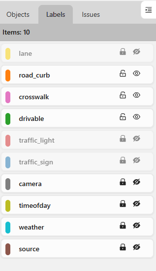
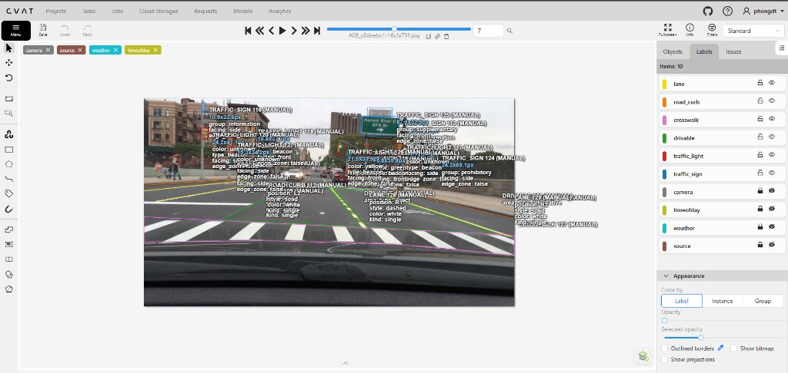
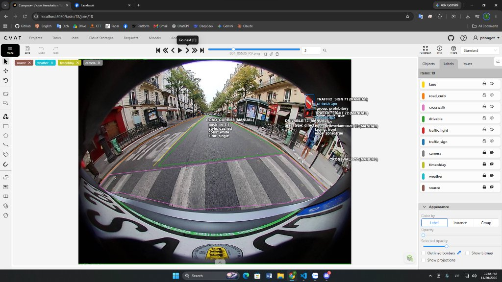
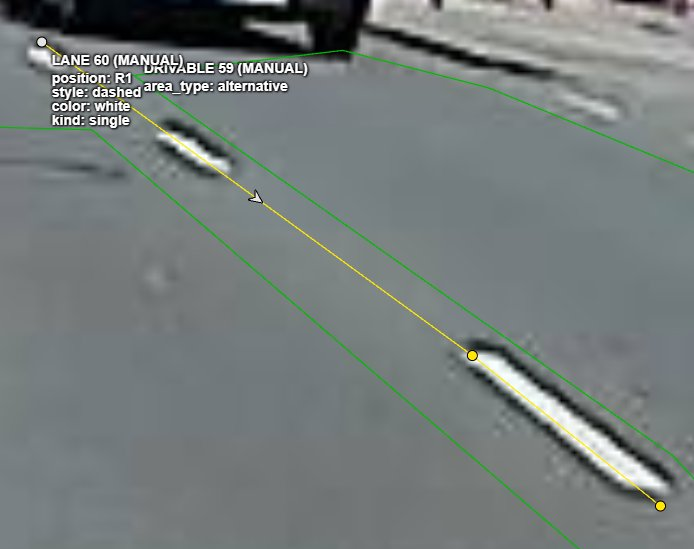
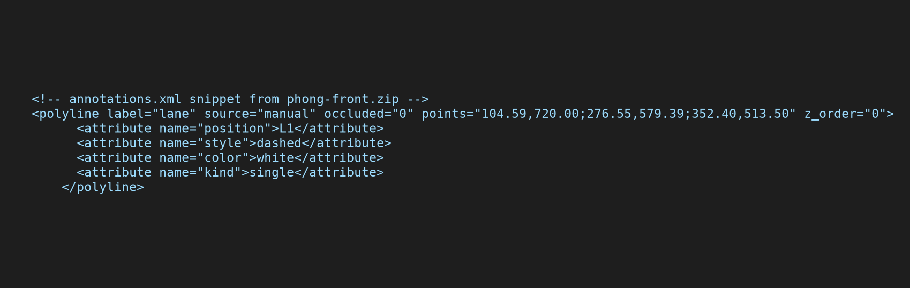

# Báo cáo cá nhân — Ngày 11
Họ tên: Đinh Trường Phong               Mã học viên: 2A202603126  
Phiên bản CVAT (Help → About): v2.82.0 (CVAT nội bộ lớp / local)  
Guideline: Road v1.0    Lần nộp (`revision` trong manifest): 1  
Thời điểm export (ngày giờ trên CVAT): 2026-11-20 22:24 UTC+7    Số lần nộp lại sau Rework: 0  

## 1. Kiểm project
| Mục | Đúng như guideline Road v1.0? | Ghi chú |
| --- | --- | --- |
| 6 label, đúng kiểu | Có | Đầy đủ lane (polyline), road_curb (polyline), crosswalk (polygon), drivable (polygon), traffic_light (rectangle), traffic_sign (rectangle) |
| Thuộc tính và giá trị | Có | Khớp hoàn toàn với taxonomy chuẩn (configs/road_v1_labels.json) |
| 4 tag ảnh | Có | Đầy đủ camera, timeofday, weather, source; mỗi tag có select value |
Cách kết thúc polyline trên bản CVAT này: Bấm phím **N** (hoặc click đúp chuột vào điểm cuối).  
Cách đặt tag ảnh trên bản CVAT này: Chọn công cụ Tag (biểu tượng thẻ ở thanh công cụ bên trái), chọn nhãn tag tương ứng, sau đó mở bảng Details ở panel bên phải để chọn giá trị `value`.  

## 2. Số lượng đã gán
| Task | Ảnh | lane | road_curb | crosswalk | drivable | traffic_light | traffic_sign |
| --- | ---: | ---: | ---: | ---: | ---: | ---: | ---: |
| front (A01–A12) | 12 | 27 | 20 | 5 | 25 | 12 | 14 |
| front-extra (đã làm 4 / 4) | 4 | 9 | 4 | 4 | 9 | 7 | 12 |
| fisheye (B01–B08) | 8 | 5 | 9 | 9 | 7 | 4 | 6 |
| fisheye-extra (đã làm 4 / 4) | 4 | 0 | 5 | 5 | 4 | 0 | 0 |

## 3. Bảng ca khó
| Ảnh | Nhãn | Phân vân giữa | Đã chọn | Lý do |
| --- | --- | --- | --- | --- |
| B06 | drivable | đường xe đi được và đường xe riêng xe bus | không đánh nhãn | như Việt Nam, xe ô tô ko đc đi vào đường bus. |
| B07 | drivable | đi vào được không ta | không đánh | đường riêng xe sô thơ . |
| B10 | drivable | đánh không vì nó như vĩa vè | có | vì thấy có ô tô đi được |

## 4. Phiếu QC 1 nhận được
Bạn kiểm lô của tôi: Tự kiểm (Self-QC qua road_check lint)  Quyết định nhận được: Release  
| Mã lỗi | Số lỗi | Đồng ý? | Đã sửa? |
| --- | ---: | --- | --- |
| QC1-04 (chiều polyline từ xa về gần) | 7 | Đồng ý | Đã vẽ lại đúng chiều từ gần xe ra xa |
| QC1-03 (position fisheye hông xe) | 3 | Đồng ý | Đã đổi sang position = other ở B06, B07, B08 |
| QC1-11 (fisheye edge_zone và cung) | 5 | Đồng ý | Đã bật edge_zone và bổ sung điểm cho vạch cong |

## 5. Kiểm file export
| File | Mở lại được? | Số shape ảnh 1 (job / file) | Số shape ảnh 2 (job / file) | Tag camera có trong XML? |
| --- | --- | --- | --- | --- |
| phong-front.zip | Có | Khớp (A01: 9 shapes) | Khớp (A02: 8 shapes) | Có (tag camera = front) |
| phong-fisheye.zip | Có | Khớp (B01: 3 shapes) | Khớp (B02: 5 shapes) | Có (tag camera = fisheye_...) |

## 6. Ảnh chụp màn hình
1. Tab Labels của project:  

2. Một ảnh camera trước đã gán đủ (làn, vùng lái, đèn/biển):  

3. Một ảnh fisheye đã gán, phóng to đoạn polyline cong:  
  
*(Chi tiết đoạn polyline cong trên fisheye:)*  

4. Một đoạn XML có `<polyline label="lane">`:  

## 7. Tự đánh giá
Lỗi bạn mắc nhiều nhất hôm nay (theo mã QC1-xx), và cách tránh ở Ngày 20:  
- Lỗi vẽ ngược chiều polyline (QC1-04) và quên quy tắc gán `position = other` ở camera hai bên sườn xe fisheye (QC1-03).
- Cách tránh ở Ngày 20: Luôn ghi nhớ quy tắc vàng là vẽ vạch từ dưới đáy ảnh (gần đầu xe) bấm dần lên phía trên xa; và luôn kiểm tra mã camera (MVL/MVR) trước khi gán thuộc tính position cho vạch làn.

Nhãn của bạn đi vào model ở đâu? Chọn một lỗi đã sửa và nói nó làm model học sai thế nào:  
- Nhãn polyline của `lane` đi trực tiếp vào các mô hình phát hiện làn đường (Lane Detection) và hệ thống hỗ trợ giữ làn tự động (Lane Keeping Assist - LKA) của xe tự hành.
- Nếu mắc lỗi QC1-03 (đặt `position = R1` cho vạch ở camera sườn xe MVL/MVR thay vì `other`), mô hình sẽ nhận sai ngữ nghĩa không gian 3D, hiểu nhầm vạch ở bên hông xe là vạch dẫn hướng bên phải của làn xe đang đi. Hậu quả là xe tự hành có thể điều khiển đánh lái lệch hướng, gây mất an toàn nghiêm trọng.

## 8. (Tùy chọn, buffer) Từ polyline đến đích row-anchor
| y | 720 | 680 | 640 | 600 | 560 |
| --- | ---: | ---: | ---: | ---: | ---: |
| x của chúng tôi | 706.2 | 651.5 | 596.8 | 542.1 | 487.0 |
| x của bạn kia | 705.8 | 652.0 | 597.0 | 541.5 | 486.5 |

Trả lời 3 câu:

1. Năm số x đó chính là đích mà một model row-anchor học cho vạch này. Nếu bạn dừng polyline sớm 40 px, hàng nào đổi thành "không có làn"?  
   - **Trả lời:** Hàng **y = 560** (hàng xa nhất trên đỉnh mà vạch vươn tới). Nếu dừng polyline sớm 40 px thì tại y = 560 sẽ không có điểm giao cắt, mô hình sẽ coi hàng này là không có làn đường.
2. So với bạn được kiểm (cùng ảnh): ở hàng 720 và hàng 560, hai bạn lệch nhau bao nhiêu pixel? Lệch ở hàng nào ảnh hưởng LKA nhiều hơn (slide 25)?  
   - **Trả lời:** Ở hàng 720 lệch khoảng 0.4 px, hàng 560 lệch khoảng 0.5 px. Lệch ở hàng **720** ảnh hưởng đến LKA nhiều hơn, vì y = 720 nằm ngay sát đầu xe (vùng cận cảnh), sai số ở đây ảnh hưởng trực tiếp đến việc tính toán góc đánh lái tức thời của xe.
3. Nếu polyline vẽ từ xa về gần (ngược quy tắc 2), cách tính trên có đổi không? Script nào sẽ gặp khó?  
   - **Trả lời:** Về mặt toán học nội suy tọa độ thì kết quả hình học không đổi, nhưng các script duyệt mảng điểm từ `pts[0]` (như thuật toán tìm điểm gần xe nhất, hay script kiểm tra chiều hướng) sẽ gặp khó khăn, phải thêm bước đảo ngược mảng hoặc nhận nhầm điểm đầu xa xôi thành gốc làn.
